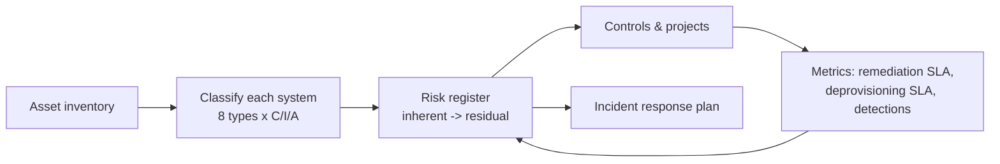

# GRC Starter Kit

> The core governance artifacts a small or mid-size organization needs to stand up a security program: a CIA-based data classification standard, a scored risk register with validation and heat maps, an asset inventory workbook with the queries to fill it, an incident response plan, and a NIST CSF 2.0 map tying it all together.


## Problem
Most security programs at smaller organizations start the same way: an auditor, client, or contract asks for "your risk register," "your data classification policy," or "your asset inventory," and none of them exist. Templates found online are either 80-page enterprise documents or empty shells with no method behind them.

## What's here
| Artifact | What makes it useful |
|---|---|
| [Data classification standard](docs/01-data-classification-standard.md) | **Eight fixed information types**, each rated for C, I, and A. The system changes between assessments but the types never do, so results stay comparable. FIPS 199 high-water mark, handling rules per level, and a worked example. |
| [Risk methodology](docs/02-risk-methodology.md) | 5×5 likelihood × impact with written definitions, CIA impact, inherent → residual scoring, an appetite threshold, and acceptance rules |
| [Risk register](register/risk_register.csv) + [generated report](register/REPORT.md) | 10 realistic example risks with treatments, owners, CSF references, and heat maps |
| [`tools/risk_report.py`](tools/risk_report.py) | **Rejects bad data**: residual higher than inherent, out-of-range scores, accepted risks with no expiry or an expired one, duplicate IDs |
| [Asset inventory workbook](inventory/asset-inventory-template.xlsx) | Six tabs (hardware, software, cloud, external domains, external authentication, third parties) with dropdowns, header notes, and a "How to collect" tab |
| [Collection queries](inventory/collection-queries.md) | KQL, Microsoft Graph, Azure Resource Graph, and AWS CLI queries to fill each tab from real sources |
| [Incident response plan](docs/03-incident-response-plan.md) | Roles, severity matrix, containment per scenario, notification decision table (HIPAA, state law, contracts, insurance), and post-incident review |
| [NIST CSF 2.0 mapping](docs/04-nist-csf-mapping.md) | Every artifact here and in the companion repos mapped to CSF functions, including the gaps |

## Risk register at a glance
```
Inherent                                  Residual (after recommended controls)
L5 | 🟩 🟨 🟧 🟥 🟥                         L5 | 🟩 🟨 🟧 🟥 🟥
L4 | 🟩 🟨 R7 R1,R2 🟥                     L4 | 🟩 🟨 🟧 🟧 🟥
L3 | 🟩 🟨 R3,R5,R9,R10 🟧 R4              L3 | 🟩 🟨 R10 🟧 🟧
L2 | 🟩 🟩 🟨 R6,R8 🟨                     L2 | 🟩 R3 R1,R4,R6,R7 🟨 🟨
L1 | 🟩 🟩 🟩 🟩 🟩                         L1 | 🟩 🟩 R5,R8,R9 R2 🟩
       I1 I2 I3 I4 I5                            I1 I2 I3 I4 I5
```
All 10 risks land within appetite (≤ 11) once the recommended controls are verified. R-010 (single-administrator dependency) is formally **accepted**, with an owner and an expiry date.

## How to use it
```bash
git clone https://github.com/sbsmith340/grc-starter-kit.git
cd grc-starter-kit
pip install openpyxl pytest
python tools/risk_report.py register/risk_register.csv     # validate + regenerate REPORT.md
python inventory/build_workbook.py                          # regenerate the workbook
pytest -q tests                                             # 9 tests
```
To adapt it for a real organization:
1. Replace "Contoso" and the example risks.
2. Set your own appetite (`APPETITE` in `risk_report.py`) and SLAs.
3. Run the collection queries.
4. Classify each system with the worksheet in the classification standard.

## How the pieces connect

The companion repos supply the controls and metrics this kit references: [KQL detection library](https://github.com/sbsmith340/kql-detection-library), [phishing triage playbook](https://github.com/sbsmith340/sentinel-phishing-triage), [remediation metrics](https://github.com/sbsmith340/vuln-remediation-metrics), and [PowerShell security toolkit](https://github.com/sbsmith340/powershell-security-toolkit).

## Limitations & what's next
- Add a BC/DR plan and a security awareness program (both listed as gaps in the CSF mapping)
- Core policy set: acceptable use, access control, change management
- Generate a one-page executive risk summary (PDF) from the register

---
Contoso and every risk, owner, and system here are fictional examples. Built by [Shawn Smith](https://sbsmith340.github.io).
